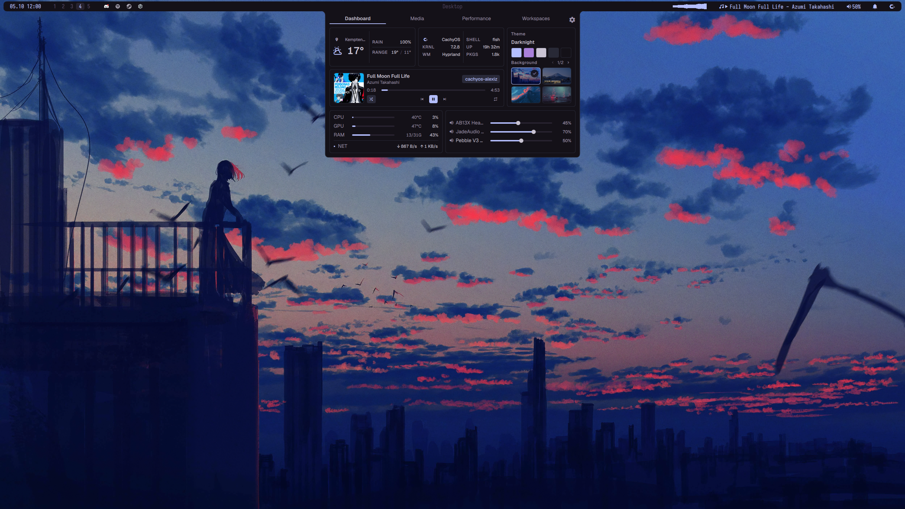

# darknight-qs

A Quickshell bar and desktop shell for a Hyprland desktop. It replaces waybar
with one unified slab: workspaces, tray, media and audio, CPU, a dashboard,
quick panels, notifications, and a power menu.

Please note that this project was mostly vibecoded.



This is personal-use software. Some modules assume my hardware and habits, so
read the [monitor](docs/user/monitors.md) and
[notification](docs/user/notifications.md) notes before you rely on it. MIT
licensed, see [LICENSE](LICENSE); third-party notices and the Omarchy trademark
disclaimer are in [NOTICE](NOTICE).

## Requirements

### Required

| Tool | Why it is needed |
| --- | --- |
| [Quickshell](https://quickshell.org) 0.3.2 or newer | the shell runtime |
| [Hyprland](https://hyprland.org) | the Wayland compositor; workspaces, focus, and window title come from Hyprland IPC |
| [PipeWire](https://pipewire.org) | audio devices and volume |
| [`cava`](https://github.com/karlstav/cava) | the audio visualizer |
| `curl` | weather and calendar fetches |
| `python3` | the calendar, Spotify, and clock helper scripts |

### Optional

| Tool | Adds |
| --- | --- |
| `playerctl` | MPRIS media controls; playback pauses on suspend |
| `mpc` | MPD control; playback pauses on suspend |
| `gcalcli` | the opt-in multi-calendar backend (see [Calendar setup](docs/user/calendar.md)) |
| `awww` | applies theme backgrounds |
| [`kitty`](https://sw.kovidgoyal.net/kitty/) | the default terminal for terminal apps and the launcher's Run row |
| one of `hyprlock`, `betterlockscreen`, `i3lock` | the power menu's Lock action |

Every optional tool degrades one feature when absent; the shell still starts.

## Install and run

### Prerequisites (Arch and CachyOS)

Install the required packages, then the optional ones you want:

```sh
# official repos
sudo pacman -S quickshell hyprland pipewire wireplumber cava curl python \
  otf-geist-mono-nerd ttc-iosevka

# optional, official
sudo pacman -S playerctl mpc awww hyprlock i3lock

# AUR: Geist UI font, gcalcli
paru -S otf-geist gcalcli
```

The AUR line assumes `paru`; substitute your AUR helper. `ttc-iosevka` is the
official Iosevka package, and `wireplumber` provides `wpctl`, which the audio
module calls to change the default sink. The three font families the shell names
are covered in [fonts](docs/user/fonts.md).

### Clone and run

Clone anywhere and run the checkout by path:

```sh
git clone https://github.com/chickenr1ce/darknight-qs ~/src/darknight-qs
~/src/darknight-qs/scripts/install.sh
quickshell -p ~/src/darknight-qs
```

`scripts/install.sh` reports the required and optional tools, the font families,
and whether another daemon holds the notification bus. It symlinks
`scripts/qs-theme.sh` to `~/.local/bin/qs-theme`, seeds the bundled `darknight`
theme into `~/.local/share/quickshell/themes`, and offers to link the clone into
`~/.config/quickshell` so plain `quickshell` loads it:

```sh
~/src/darknight-qs/scripts/install.sh --link
quickshell
```

`quickshell -p <dir>` works from any clone path; the link is only a shortcut.
The installer also offers to wire your themed apps; see [Theme desktop
setup](docs/user/theme-desktop-setup.md).

### Autostart

Add autostart to your own Hyprland config. The installer prints this line and
never edits your config:

```
exec-once = quickshell -p /home/<you>/src/darknight-qs
```

Once the clone is linked into `~/.config/quickshell`, `exec-once = quickshell`
is enough.

## Updating

Updates are a `git pull` in the clone, on the `main` branch:

```sh
cd ~/src/darknight-qs
git pull --ff-only
```

Quickshell watches its config files and reloads when their content changes, so
a pull reloads the bar on its own. A restart is still the reliable step after a
structural change: a new file, a `qmldir`, or an import. Settings live in XDG
state and cache (`~/.local/state/quickshell`, `~/.cache/quickshell`), not the
repo, so they survive an update.

`scripts/update.sh` runs the whole step. It refuses a dirty tree, pulls `main`
fast-forward only, re-checks dependencies, and restarts the shell on this clone:

```sh
~/src/darknight-qs/scripts/update.sh
```

## Documentation

Setup and how-to pages live under [`docs/`](docs/README.md). The most used ones:

- [Monitors](docs/user/monitors.md), [notifications](docs/user/notifications.md), and [fonts](docs/user/fonts.md).
- [qs-theme](docs/user/qs-theme.md) and [theme desktop setup](docs/user/theme-desktop-setup.md) for themes and backgrounds.
- [Polkit](docs/user/polkit.md) for the authentication prompt.
- [App launcher](docs/user/app-launcher.md) for the dashboard Apps tab.
- [Audio card](docs/user/audio.md) for output, input, and per-app volume.
- [Workspaces tab](docs/user/workspaces-tab.md) for the dashboard workspace overview.
- [IPC targets](docs/user/ipc.md) for keybind-driven panels.
- [Calendar](docs/user/calendar.md), [weather](docs/user/weather.md), and [Spotify Connect](docs/user/spotify-connect.md) for the optional integrations.

## Trademarks and third-party notices

Omarchy is a trademark of its owner (see https://omarchy.org/brand/).
darknight-qs is an independent community project: it is not affiliated with
or endorsed by the Omarchy project or 37signals.

`services/ThemeParsers.js` ports the color cascade from Omarchy's
`bin/omarchy-theme-color`; Omarchy is MIT licensed and its notice is kept in
[NOTICE](NOTICE). Imported themes are third-party content with their own
licenses, downloaded by the user and not redistributed by this repository.

The two background images bundled with the `darknight` theme are third-party
artwork, credited to their authors in [NOTICE](NOTICE), not covered by this
repository's MIT license, and included with all rights remaining with the
artists.
